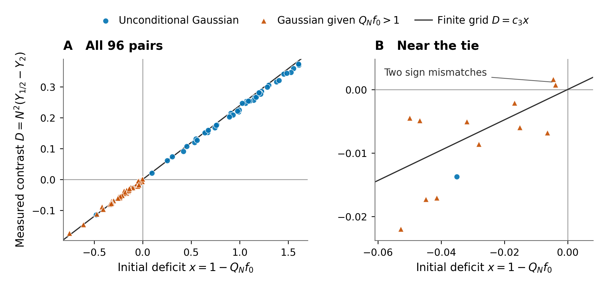

# Steering a network’s inductive bias with the hidden-layer learning rate

Two copies of a ReLU network start from the same Gaussian weights and train on the same labeled points around a circle. Changing only the hidden-layer learning rate produces a difference in their average predictions around the whole circle. With probability tending to one as the grid grows, both copies fit the training labels and the initial grid mean predicts the sign and size of their difference. We prove this for full-batch gradient descent and gradient flow. **Both theorems are formalized entirely in Lean.**

[Paper (PDF)](paper/paper.pdf) · [Read on GitHub](paper/paper.md) · [First-principles derivation](docs/from-first-principles.md) · [Lean formalization](formal/)

## The prediction

Take an odd number $N\ge3$ of equally spaced angles on the unit circle with labels $y(u)=1+\cos u$. Let $Q_N$ denote the mean on the training grid and $Q$ the uniform angular mean. Both label means equal one. For the common initial network $f_0$, measure the **initial deficit** $X=1-Q_Nf_0$.

Fix the readout rate at one. Set the hidden rate to $1/2$ in the slow copy and $2$ in the fast copy. Write $Y_{1/2}$ and $Y_2$ for their population means (predictions averaged under $Q$) at the common endpoint specified below. As odd $N$ grows, the slow-minus-fast gap satisfies

$$
Y_{1/2}-Y_2 = \frac{\pi^2}{40}\,\frac{1-Q_N f_0}{N^2} + o_p(N^{-2}).
$$

When the initial grid mean is below one, the slower rate is predicted to finish higher. When it is above one, the choice reverses. With probability tending to one, both copies have grid RMS error at most $N^{-3}$, the **fitting tolerance**. Their grid predictions then differ by at most $2N^{-3}$ in RMS. When the initial deficit has magnitude bounded above and away from zero, the population gap has order $N^{-2}$ on the event where the prediction is accurate. The training choice steers an aspect of the learned function that the fit leaves undetermined.

## The two theorems

At width $m=N^{32}$ the network is $f(u)=m^{-1/2}\sum_{j=1}^m a_j[w_j^\top(\cos u,\sin u)]_+$. All weight coordinates are initially independent standard Gaussians. Both copies minimize half the mean squared grid error. Take $H=\lceil2\pi^2N^2\log(2\sqrt{12}\,N^{7/2})\rceil$ simultaneous unit-step gradient descent (GD) updates, or train by flow until time $H$. GD takes the ReLU derivative to be zero at the kink. The flow theorem covers every admissible measurable choice of Clarke gradient-flow paths. [Discrete update](formal/CircleWeightedStep.lean#L23) · [Flow construction](formal/CircleFlowConstruction.lean#L75)

At each hidden rate $\tau$, let $k_\tau$ be the initialization-averaged tangent kernel, with readout weight one and hidden weight $\tau$ in the gradient inner product. Fitting the labels with that kernel held fixed transfers a fraction $b_{\tau,N}=Qk_\tau(\cdot,0)/Q_Nk_\tau(\cdot,0)$ of the initial grid deficit to the population mean. Subtracting the two fitted kernel means gives $c_NX/N^2$ with $c_N=N^2(b_{1/2,N}-b_{2,N})>0$ and $c_N\to\pi^2/40$. [Exact coefficient](formal/CircleFiniteCoefficient.lean#L118) · [Expansion](formal/CircleFiniteCoefficient.lean#L231)

Write $\Delta=Y_{1/2}-Y_2$ for the actual trained gap and $D=N^2\Delta$. The bounds below hold for all sufficiently large odd $N$. Probability and RMS are over the common Gaussian initialization. A tie counts as an ordering error.

| Training | Fitting and ordering | Error across all seeds |
| --- | --- | --- |
| [Discrete GD](formal/CirclePairedGDTheorem.lean#L59) | With probability at least $1-2/\sqrt N$, both copies fit and $\lvert D-c_NX\rvert\le10N^{-33/32}$. The ordering error probability is $O(N^{-1/2})$. | $D-(\pi^2/40)X$ converges to zero in probability. The unscaled mean-square error $\mathbb{E}[(\Delta-dX/N^2)^2]$ diverges for both $d=c_N$ and $d=\pi^2/40$. |
| [Gradient flow](formal/CirclePairedTheorem.lean#L209) | Both copies fit with probability $1-O(N^{-158})$. The ordering error probability is $O(N^{-13})$. | The RMS error of $\Delta$ against $c_NX/N^2$ is $O(N^{-15})$. Using the limiting coefficient $\pi^2/40$ gives RMS error of order $N^{-4}$. |

Because $\mathbb{E}[X]=1$, flow also has a predictable **signed shift averaged over seeds**, $\mathbb{E}[\Delta]=\pi^2/(40N^2)+O(N^{-4})$. For GD, rare initializations make the fast copy’s output outgrow the slow copy’s by enough to force mean-square divergence. The signed expectation for GD remains open. [Signed flow expectation](formal/CirclePairedTheorem.lean#L264) · [Flow RMS constant](formal/CirclePairedSecondOrder.lean#L93) · [Discrete rare-seed proof](docs/paired-discrete-gd.md#why-the-squared-error-diverges)

The paper also treats equal layer rates. With both rates set to one, the variance of GD’s population mean scales as $7\pi^2/(1620N^4)$ at $\lceil\pi^2\log N\rceil$ updates. At $\lceil60\log N\rceil$ and at $H$ the unscaled variance diverges, even though the network fits with probability tending to one at $H$. [Three-endpoint comparison](docs/from-first-principles.md#how-long-you-train-also-matters)

## Numerical experiment

The figure compares the prediction to numerical gradient flow at $N=3$, width 32,768 and time 160. Each point is a pair of runs from a shared seed. Its horizontal coordinate is the initial deficit, its vertical coordinate the observed scaled gap. The line has the predicted finite-grid slope $c_3\approx0.239159$.



The deficit predicted the ordering in **48 of 48** ordinary Gaussian pairs. Always choosing the slower copy scores 45 of 48. For an independent sample drawn conditional on $X<0$, the formula predicts the faster copy will finish higher. It did so in **46 of 48** pairs. Both misses had initial grid means within 0.005 of one. [Data and reproduction](layer-rates/) · [Counts checked in Lean](formal/CirclePairedData.lean#L114)

## Replay the proofs

From the repository root with Git, Python 3.11 or newer, and elan installed, run

```sh
cd formal
lake exe cache get
python3 verify.py --report .lake/replay
```

The verifier rebuilds the project and submits the same export to `leanchecker` and `leanchecker-paranoid`. Both accepted all 7,404 safe project declarations, including 6,131 theorems. The paper also embeds the Lean sources and replay instructions as a PDF attachment. [Proof guide](docs/proof-guide.md) · [Verification receipt](formal/verification/receipt.json)
